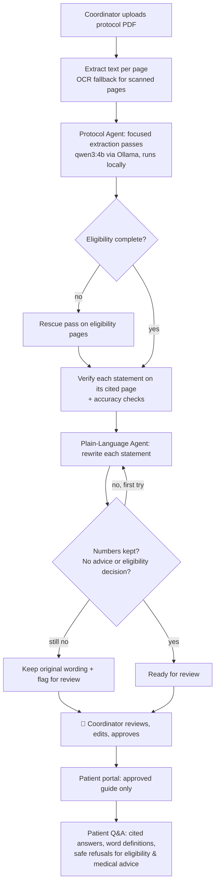

# Clinical Trial AI — Project Brief

PEAAII AI Applications Hackathon 2026 · Theme: Agentic AI

## 1. Problem

Clinical trial protocols are long, technical documents written for researchers. Patients
considering a trial struggle to understand who can join, what each visit involves, and what the
risks are. Research coordinators repeatedly explain the same details by hand, and every summary
they write must keep the protocol's numbers exactly right: an age limit, a lab threshold or a
visit day that is changed or dropped can mislead a patient.

## 2. Target users

| User | Need |
|---|---|
| **Research coordinators** at hospitals and research sites | Pull eligibility, visits, procedures and safety information out of a protocol quickly, with page references, and produce patient materials they can trust |
| **Patients and caregivers** considering a trial | Understand the trial in everyday language, look up medical words, and know what to ask the study team, without being told "you are eligible" by a machine |

## 3. Solution

A web app (Streamlit) where a coordinator uploads a protocol PDF. AI agents extract the key
information, check it against the source pages, and write a plain-language patient guide that
the coordinator reviews and approves before patients see it. Patients read the approved guide
and ask questions; the assistant explains, cites sources, and refuses eligibility decisions and
medical advice.

## 4. Why this is Agentic AI (not a chatbot)

| Agentic capability (from the brief) | Where it happens |
|---|---|
| Breaking a task into steps / planning | Protocol Agent runs separate focused extraction passes (metadata + eligibility + safety; visits + procedures) |
| Making decisions from intermediate results | If eligibility looks incomplete, the agent decides to run an extra "rescue" pass on the eligibility pages |
| Using tools | PDF text extraction, OCR for scanned pages, source-page verifier, medical glossary, number and safety checkers |
| Evaluating its own results | Every extracted statement is checked on its cited page; every patient rewrite is checked for missing/changed numbers and unsafe wording |
| Retrying with feedback | A failed rewrite is sent back to the model with the exact problems, once |
| Asking a human when necessary | Anything the agent cannot fix is flagged; nothing reaches patients without coordinator approval |

## 5. Workflow

## 6. Definition of Done

Given a clinical trial protocol PDF, the system:

1. Extracts inclusion criteria, exclusion criteria, visits, procedures and safety information,
   each with its source page, and flags statements it cannot verify on that page.
2. Produces a plain-language patient guide in which every number from the protocol is preserved
   and no text gives medical advice or an eligibility decision; failures are flagged, never hidden.
3. Shows patients **only** guide items a coordinator has approved.
4. Answers patient questions from verified content with citations, defines common medical terms,
   and refuses "Am I eligible?" and medical-advice questions, pointing to the study team.
5. Runs locally (no protocol text sent to external AI services).

**Success criteria** (measured in [`EVALUATION.md`](../EVALUATION.md)): 100% of risky patient
questions answered safely; 100% of unsafe rewrites caught by the guardrail; extraction recall
and page accuracy reported on real public protocols.

## 7. How it compares with existing options

| Option | Limitation for this problem | What we add |
|---|---|---|
| Reading the full protocol | Long and technical; not written for patients | Structured summary with page references, plain language |
| Trial registries (e.g. ClinicalTrials.gov listings) | Help people *find* trials; eligibility text is still technical | Explains one protocol in depth, with a glossary and Q&A |
| General-purpose AI chatbots | Can change numbers, imply eligibility, and give advice; no approval step | Numbers are checked, eligibility/advice is refused, coordinator approves before publication |
| Coordinator writes summaries by hand | Time-consuming, repeated for every protocol | Draft generated and self-checked; coordinator only reviews flagged items |

## 8. Practical value

- Saves coordinator time: review and approve instead of writing from scratch.
- Patients get understandable, source-backed information before talking to the study team.
- Privacy by design: runs on a local model; uses public/synthetic protocols only.

## 9. Limitations and risks

See [`EVALUATION.md` §4](../EVALUATION.md#4-known-limitations--failure-cases). Research prototype:
not for clinical decisions, not a replacement for informed consent.

## 10. Team

| Member | Contribution |
|---|---|
| Rakesh | Team lead · PDF processing & OCR · Protocol Analysis Agent · verification · Coordinator & Patient Q&A · Streamlit app |
| Nam | Plain-Language Patient Guide agent · coordinator review & approval UI · glossary · evaluation framework & results · documentation · demo |
| Raj | _fill in_ |
